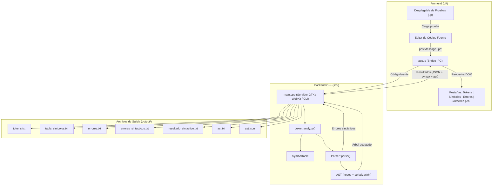

# LexLP Studio — Analizador Léxico y Sintáctico (Lenguaje LP)

[](https://isocpp.org/)
[](https://www.gtk.org/)
[](https://developer.mozilla.org/)


**LexLP Studio** es el analizador léxico y sintáctico (Fases 1 y 2 del compilador) para el lenguaje de programación personalizado **LP**.

El proyecto implementa una arquitectura híbrida de alto desempeño: un **backend en C++17** que procesa el flujo léxico, gestiona la tabla de símbolos y detecta errores en una sola pasada, conectado mediante un **puente IPC nativo (GTK 3 + WebKit2GTK)** a una **interfaz gráfica moderna (UI)** desarrollada con tecnologías web. Además, cuenta con un **modo CLI** optimizado para evaluación y pruebas automatizadas por terminal.

---

## 🚀 Características Principales

* **Motor Léxico Integral (C++17):**
  * Reconocimiento según la regla del prefijo más largo (*Maximal Munch*) y autómatas finitos deterministas (DFA).
  * Soporte de *lookahead* para resolver operadores de 1 y 2 caracteres (`=`, `==`, `!`, `!=`, `<`, `<=`, `>`, `>=`, `&&`, `||`, `/`, `//`).
  * Normalización automática de comillas tipográficas UTF-8 (`“ ”`) a comillas dobles estándar (`"`).
  * Filtrado y descarte transparente de comentarios de una línea (`//.*\n`) actualizando filas y columnas.
* **Manejo Robusto de Errores Léxicos (Sin Falsos Positivos):**
  * **Números mal formados consolidados:** Cadenas inválidas como `1.2.3`, `1..2`, `42.` o `123abc` son absorbidas como un único error léxico en lugar de dividirse erróneamente en tokens parciales.
  * **Identificadores inválidos agrupados:** Variables ilegales como `@variableInvalida` o `$precio` se marcan completas como error léxico, evitando contaminar la tabla de símbolos o emitir tokens `<ID>` falsos.
  * **Cadenas no cerradas:** Detección de constantes de texto que no cierran comillas antes del salto de línea o fin de archivo.
* **Tabla de Símbolos en Tiempo Real:**
  * Almacenamiento en estructura híbrida (`std::unordered_map` y `std::vector`) para inserción y búsqueda en $O(1)$ garantizando orden secuencial sin identificadores duplicados.
  * Asociación de atributos posicionales en el formato `<ID, pos>`.
* **Doble Modo de Ejecución:**
  * **Modo GUI (Escritorio):** IDE interactivo con selector desplegable de pruebas, visor de tokens por categorías, tabla de símbolos y lista de errores en vivo.
  * **Modo CLI (Terminal):** Ejecución directa (`./lexlp archivo.lp`) diseñada para calificación automatizada.
* **AST navegable:** representación textual y JSON del árbol sintáctico, visible en la GUI.
* **Exportación Automática a Disco (`output/`):**
  * Genera tras cada análisis los archivos exigidos para la entrega: `tokens.txt`, `tabla_simbolos.txt`, `errores.txt`, `errores_sintacticos.txt`, `resultado_sintactico.txt`, `ast.txt` y `ast.json`.

---

## 📁 Estructura del Proyecto

```text
.
├── Makefile                # Script de compilación (g++ C++17, GTK 3, WebKit2GTK)
├── README.md               # Documentación general del proyecto
├── actualizacion.md        # Documentación histórica del Entregable 1
├── informe_entregable2.md  # Informe técnico del Entregable 2 (AST y parser completo)
├── lexlp                   # Binario ejecutable compilado
├── output/                 # Reportes generados por la ejecución
│   ├── tokens.txt          # Secuencia lineal continua de tokens
│   ├── tabla_simbolos.txt  # Tabla de símbolos con identificadores únicos
│   ├── errores.txt         # Reporte tabulado de errores léxicos
│   ├── errores_sintacticos.txt  # Errores del parser
│   ├── resultado_sintactico.txt # ACEPTADO / RECHAZADO / NO EJECUTADO
│   ├── ast.txt             # Árbol de sintaxis abstracta en texto
│   └── ast.json            # AST estructurado para la GUI
├── src/                    # Código fuente del motor en C++
│   ├── Lexer.h / .cpp      # Escáner léxico, DFA, lookahead y reglas
│   ├── Parser.h / .cpp     # Parser por descenso recursivo
│   ├── AST.h / .cpp        # Nodos, serialización JSON y árbol textual
│   ├── SymbolTable.h / .cpp# Tabla de símbolos (hash map + vector)
│   ├── Token.h / .cpp      # Estructuras Token, LexerError y TokenType
│   └── main.cpp            # Punto de entrada, modo CLI y ventana GTK/WebKit
├── tests/                  # Suites de prueba en lenguaje LP
│   ├── prueba_basica.lp    # Aritmética, variables y salida básica (léxica)
│   ├── prueba_completa.lp  # Cobertura léxica de tipos, control y operadores
│   ├── prueba_errores.lp   # Símbolos inválidos (@, $), 1.2.3, cadenas abiertas
│   ├── prueba_limite.lp    # Casos límite (guiones bajos, números mal formados)
│   ├── sintactico/         # Casos válidos e inválidos del Entregable 1
│   └── e2/                 # Casos válidos e inválidos del Entregable 2
│       ├── validos/        # Programas que deben aceptarse
│       └── invalidos/      # Programas que deben rechazarse
└── ui/                     # Frontend de la interfaz gráfica
    ├── app.js              # Lógica de cliente, puente IPC y renderizado dinámico
    ├── carlos-gif.gif      # GIF decorativo siempre visible en la esquina
    ├── index.html          # Vista HTML del editor y paneles de resultados
    └── style.css           # Estilos visuales con tema oscuro tipo IDE
```

---

## 📜 Especificación de Tokens y Expresiones Regulares

| Expresión Regular | Token Generado | Formato de Salida | Categoría |
| :--- | :---: | :---: | :--- |
| `D = [0-9]` *(Auxiliar)* | — | — | Dígito numérico |
| `L = [a-zA-Z_]` *(Auxiliar)* | — | — | Carácter de identificador |
| `NUM_INT = D+` | `NUM_INT` | `<NUM_INT>` | Número entero |
| `NUM_DEC = D+\.D+` | `NUM_DEC` | `<NUM_DEC>` | Número decimal |
| `ID = L(L\|D)*` | `ID` | `<ID, pos>` | Identificador *(con posición en tabla)* |
| `TEXTO = “.*”` o `".*"` | `TEXTO` | `<TEXTO>` | Constante de texto |
| `int`, `float`, `char`, `boolean`, `void` | `INT`, `FLOAT`, etc. | `<TIPO>` | Palabras reservadas (Tipos) |
| `if`, `else`, `for`, `while` | `IF`, `ELSE`, etc. | `<PALABRA>` | Palabras reservadas (Control) |
| `scanf`, `println`, `main`, `return`, `func` | `SCANF`, `PRINTLN`, etc. | `<PALABRA>` | Palabras reservadas (E/S, función y llamadas) |
| `COMENT = //.*\n` | *(Ignorado)* | — | Comentario de una línea *(sin token)* |
| `=` | `=` | `<=>` | Operador de asignación |
| `+`, `-`, `*`, `/`, `%` | `+`, `-`, `*`, `/`, `%` | `<+>`, `<->`, etc. | Operadores aritméticos |
| `&&`, `\|\|`, `!` | `&&`, `\|\|`, `!` | `<&&>`, `<\|\|>`, `<!>` | Operadores lógicos |
| `COMP = > \| >= \| < \| <= \| != \| ==` | `COMP` | `<COMP>` | Operadores de comparación / relacionales |
| `(`, `)`, `[`, `]`, `{`, `}`, `,`, `;` | `(`, `)`, etc. | `<(>`, `<;>`, etc. | Símbolos especiales / delimitadores |

---

## 🧩 Analizador Sintáctico y AST (Entregables 1 y 2)

El parser se implementa mediante **descenso recursivo predictivo** y consume
directamente la secuencia de tokens producida por `Lexer::analyze()`. No vuelve a
analizar caracteres del archivo fuente. Cada método del parser corresponde a un
no terminal de la gramática.

### Alcance actual

- `PROGRAMA → LISTA_FUNCIONES PRINCIPAL`
- `PRINCIPAL → [void] main ( ) BLOQUE`
- `BLOQUE → { LISTA_VARIABLES COMANDOS }`
- Declaraciones: `TIPO`, `TIPO_BASE`, `DIMENSION`, `LISTA_VARIABLES` y `LISTA_ID`.
- Asignaciones: `ASIGNACION`, `COMPLEMENTO` y la jerarquía completa de expresiones.
- Funciones: declaraciones, tipos de retorno, parámetros y llamadas `func` como
  complemento de asignación o como comando.
- Entrada/salida: `scanf` y `println` con sus listas de términos.
- Control: `if/else` y `while` con condiciones y bloques.
- Retorno: `return EXPRESION ;` (la gramática no admite `return;`).
- Errores con línea, columna, token encontrado y token esperado.
- Recuperación de errores para continuar el análisis cuando es viable.
- Construcción de un **AST** con nodos y roles, exportado a texto y JSON.

Se acepta tanto `void main()` (forma usada en los ejemplos del enunciado) como
`main()` (forma literal de la gramática). También se aceptan dimensiones
posteriores al identificador (`int datos[10];`, usada en los ejemplos) además de
la forma prefija de la gramática (`int[10] datos;`). `for` no pertenece a la
gramática de LP y se reporta explícitamente.

### AST

El AST se construye durante el análisis sintáctico y se guarda en:

- `output/ast.txt`: representación textual con roles (`condition`, `then`,
  `else`, `body`, `term`, etc.).
- `output/ast.json`: representación estructurada para la interfaz gráfica.

La pestaña **AST** de la GUI muestra el árbol de forma navegable. El AST solo se
genera cuando el programa es aceptado sintácticamente.

### Resultado del parser

El análisis sintáctico se considera exitoso solo si el lexer no reportó errores
y no se encontró ningún error sintáctico. Los resultados se guardan en:

- `output/errores_sintacticos.txt`
- `output/resultado_sintactico.txt`
- `output/ast.txt`
- `output/ast.json`

### Cobertura de la gramática y compatibilidad

La implementación cubre **todas las producciones** de la gramática de LP:
estructura del programa, funciones, parámetros, declaraciones, bloques,
asignaciones, expresiones, `scanf`, `println`, `if/else`, `while` y `return`.

Para mantener compatibilidad con los ejemplos del enunciado se aceptan estas
extensiones, que deben interpretarse como un **superconjunto** de la gramática:

| Extensión | Ejemplo | Motivo |
|---|---|---|
| `void` opcional en `main` | `void main()` | Todos los ejemplos lo usan. |
| Dimensión postfija | `int datos[10];` | Forma usada en los ejemplos. |
| Dimensión postfija en parámetros | `int suma(int datos[10])` | Compatibilidad con arreglos. |
| Asignación a posición de arreglo | `datos[i] = i + 1;` | Ejemplos con arreglos. |
| `;` opcional tras `func` como comando | `func saluda();` | Notación habitual de llamadas. |

Decisiones estrictas:

- `return;` se rechaza: `RETORNO` exige una expresión.
- `int main()` se rechaza con un mensaje específico.
- `for` no pertenece a LP y se rechaza explícitamente.
- `else if` se rechaza: `SINO → else BLOQUE`, no `else if`.
- `scanf()` y `println()` vacíos se rechazan.
- `scanf` solo acepta identificadores con índices; `println` acepta
  identificadores, constantes o texto.
- Las declaraciones locales deben ir antes de los comandos del bloque.
- La comparación es no asociativa: solo se admite un `COMP` por expresión
  relacional.

La gramática usa recursión por la derecha en las expresiones. El parser
reconoce las mismas cadenas, pero construye el AST con **asociatividad por la
izquierda** para los operadores binarios (`a - b - c` se agrupa como
`(a - b) - c`). La precedencia sí coincide con las producciones. Esta decisión
está documentada en `informe_entregable2.md`.

---

## ⚙️ Arquitectura y Flujo de Comunicación



---

## 🛠️ Instalación y Compilación

### Prerrequisitos (Linux)

El proyecto requiere un compilador con soporte para **C++17** y las librerías de desarrollo de **GTK+ 3** y **WebKit2GTK** (versión 4.1 o 4.0):

#### En Ubuntu / Debian / Linux Mint:
```bash
sudo apt update
sudo apt install build-essential pkg-config libgtk-3-dev libwebkit2gtk-4.1-dev
# Si tu distribución utiliza la rama 4.0:
# sudo apt install libwebkit2gtk-4.0-dev
```

#### En Arch Linux / Manjaro:
```bash
sudo pacman -S base-devel pkgconf gtk3 webkit2gtk-4.1
```

#### En Fedora / RHEL:
```bash
sudo dnf install gcc-c++ make pkgconfig gtk3-devel webkit2gtk4.1-devel
```

### Compilación

Para compilar el proyecto y generar el binario ejecutable `lexlp`:

```bash
# Compilación estándar
make

# Limpieza y recompilación completa desde cero
make clean && make

# Pruebas de los Entregables 1 y 2 (válidos e inválidos)
make test

# Validación del AST y de su JSON
make test-ast
```

---

## 🚀 Uso del Programa

### 1. Modo Gráfico (GUI)
Ejecuta el binario sin argumentos:
```bash
./lexlp
```
1. En la barra superior, usa el **menú desplegable** para elegir una prueba. Las opciones de sintaxis válida/inválida, las del **Entregable 2** (integral, funciones y E/S) y los casos de arreglos están pensadas para demostrar el parser; las pruebas básicas también sirven como evidencia léxica.
2. Modifica o escribe código libremente en el panel izquierdo. El editor muestra la numeración de líneas a la izquierda y la posición actual del cursor en el encabezado (`L: línea | C: columna`).
3. Presiona **▶ Analizar Código**.
4. Revisa los resultados en las pestañas derechas:
   * **Tokens:** Etiquetas coloreadas con formato `<TIPO>` o `<ID, pos>`.
   * **Tabla de Símbolos:** Relación `Posición` e `Identificador`.
   * **Errores Léxicos:** Tabla con `Línea`, `Columna`, `Lexema` y estado `ERROR_LEXICO`.
   * **Sintáctico:** Resultado `ACEPTADO`/`RECHAZADO`, errores del parser y estado “no ejecutado” cuando el lexer falla.
   * **AST:** Árbol navegable con tipos de nodo, valores, roles y ubicación. Solo aparece cuando el programa es aceptado.
5. En la esquina inferior derecha se muestra `ui/carlos-gif.gif` en bucle infinito, siempre por encima de los paneles y sin bloquear la interacción.

### 2. Modo Consola (CLI)
Ideal para pruebas automatizadas y corrección docente por lotes:
```bash
# Pruebas léxicas históricas
./lexlp tests/prueba_basica.lp
./lexlp tests/prueba_completa.lp
./lexlp tests/prueba_errores.lp
./lexlp tests/prueba_limite.lp

# Entregable 1
./lexlp tests/sintactico/valido_minimo.lp
./lexlp tests/sintactico/invalido_sin_punto_coma.lp

# Entregable 2
./lexlp tests/e2/validos/integral.lp
./lexlp tests/e2/validos/funciones.lp
./lexlp tests/e2/validos/io_arreglos.lp
./lexlp tests/e2/invalidos/main_con_tipo.lp
```
El analizador procesará el archivo fuente, ejecutará el lexer y, si no hay errores léxicos, el parser. Imprimirá el resultado sintáctico (`ACEPTADO` o `RECHAZADO`), los errores encontrados y, cuando el programa sea aceptado, la ruta del AST generado. Todas las salidas se escriben en `output/`.

Códigos de salida del modo CLI:

| Código | Significado |
|:---:|---|
| `0` | Programa aceptado sintácticamente |
| `1` | Errores léxicos o sintácticos, o error de lectura/escritura |
| `2` | Uso incorrecto del comando |

Los archivos del lexer se siguen generando aunque el parser rechace el programa, para conservar la evidencia de la fase léxica.

> Las pruebas históricas del lexer usan `return;`, que la gramática del Entregable 2 no admite, y `for`, que no pertenece a LP. Por eso pueden ser rechazadas sintácticamente. Para la aceptación sintáctica deben usarse los casos de `tests/sintactico/` y `tests/e2/validos/`.

---

## 🧪 Casos de Prueba Incluidos (`tests/`)

* **[`tests/prueba_basica.lp`](tests/prueba_basica.lp):** Declaración de variables `int` y `float`, operadores aritméticos básicos (`+`, `*`), cadenas de texto y llamada a `println`.
* **[`tests/prueba_completa.lp`](tests/prueba_completa.lp):** Cobertura exhaustiva de palabras clave, tipos (`char`, `boolean`), arreglos unidimensionales (`datos[10]`), bucles `while`/`for`, condicionales `if`/`else`, operadores lógicos compuestos (`&&`, `||`, `!`), comparaciones relacionales (`<=`, `>=`, `!=`) y comentarios.
* **[`tests/prueba_errores.lp`](tests/prueba_errores.lp):** Verificación de detección de símbolos no permitidos (`@variableInvalida`, `$precio`), operadores lógicos solitarios (`&`, `|`), números mal formados (`1.2.3`) y cadenas no cerradas.
* **[`tests/prueba_limite.lp`](tests/prueba_limite.lp):** Casos límite (*edge cases*): identificadores válidos con guiones bajos iniciales (`_contador`, `__init__`), decimales sin dígitos tras el punto (`42.`), múltiples puntos (`1..2`, `1.2.3.4`), números pegados a letras (`123abc`, `1.2x`) y cadenas con comillas escapadas.

### Pruebas del analizador sintáctico

La carpeta [`tests/sintactico/`](tests/sintactico/) contiene los casos del Entregable 1:

* `valido_minimo.lp`: ejemplo mínimo del enunciado con `void main()`.
* `valido_estricto.lp`: `main()` sin `void` y declaraciones con arreglos.
* `valido_expresiones.lp`: asignaciones con expresiones y paréntesis.
* `valido_funciones.lp`: función top-level y llamada con `func`.
* `invalido_sin_punto_coma.lp`: falta de `;` en una declaración.
* `invalido_llave_sin_cerrar.lp`: bloque sin `}`.
* `invalido_token_inesperado.lp`: token que no inicia un comando.
* `invalido_declaracion_despues_comando.lp`: declaración después de un comando.
* `invalido_parentesis_sin_cerrar.lp`: expresión sin `)`.

La carpeta [`tests/e2/`](tests/e2/) contiene los casos del Entregable 2:

* `validos/integral.lp`: ejemplo integral con `if/else`, `while`, `println` y `return`.
* `validos/funciones.lp`: funciones, parámetros, retorno y llamada `func`.
* `validos/io_arreglos.lp`: `scanf`, `println` y arreglos.
* `validos/control.lp`: control de flujo anidado.
* `validos/expresiones.lp`: precedencia y operadores.
* `validos/main_simple.lp`: `main()` sin `void` y dimensión prefija.
* `validos/funcion_comando.lp`: llamada `func` como comando.
* `invalidos/*.lp`: errores de punto y coma, llaves, paréntesis, `else` sin `if`,
  `scanf`/`println` vacíos, `return;`, `for`, `int main()`, declaración después
  de comando y llamadas mal cerradas.

El comando `make test` ejecuta ambos conjuntos y `make test-ast` valida la
generación y el JSON del AST.


---

## 📄 Archivos de Salida Generados (`output/`)

Tras cada ejecución (tanto en GUI como en CLI), se actualizan automáticamente:

1. **`output/tokens.txt`:** Cadena continua de tokens delimitados por espacios:
   ```text
   <VOID> <MAIN> <(> <)> <{> <INT> <ID,0> <=> <NUM_INT> <;> <RETURN> <;> <}>
   ```
2. **`output/tabla_simbolos.txt`:** Lista tabulada de identificadores únicos registrados:
   ```text
   Posición	Identificador
   0		valorA
   1		valorB
   ```
3. **`output/errores.txt`:** Reporte tabulado de fallos léxicos detectados:
   ```text
   Línea	Columna	Lexema	Resultado
   5	9	@variableInvalida	ERROR_LEXICO
   9	28	1.2.3	ERROR_LEXICO
   ```
4. **`output/errores_sintacticos.txt`:** Errores del parser con línea, columna,
   token encontrado, token esperado y mensaje:
   ```text
   Línea	Columna	Encontrado	Esperado	Mensaje
   5	9	edad	;	Se esperaba ';'; se encontró 'edad'.
   ```
5. **`output/resultado_sintactico.txt`:** Resultado global (`ACEPTADO`,
   `RECHAZADO` o `NO EJECUTADO`).
6. **`output/ast.txt`:** Árbol de sintaxis abstracta en texto, con roles.
7. **`output/ast.json`:** AST estructurado para la pestaña de la GUI; contiene
   `null` cuando el programa no fue aceptado.

Ejemplo de `output/ast.txt` para un programa mínimo:

```text
Program
  [main]
    Main main
      [body]
        Block
          [declaration]
            VarDecl int
              [type]
                Type int
              [declarator]
                Declarator edad
          [command]
            Assign
              [target]
                Identifier edad
              [value]
                Literal 20 (num_int)
```

---

## ⚠️ Limitaciones conocidas

- **Sin análisis semántico:** no se comprueba declaración de variables,
  compatibilidad de tipos ni ejecución del programa.
- **Rutas relativas:** el binario debe ejecutarse desde la raíz del repositorio
  para cargar `ui/index.html` y escribir en `output/`.
- **Artefactos generados:** `output/*.txt` y `output/*.json` son reportes de
  ejecución; no deben versionarse.
- **Columnas UTF-8:** dentro de cadenas se cuentan codepoints; fuera de ellas se
  cuentan bytes.
- **`COMP` sin lexema en la salida de tokens:** el token se muestra como
  `<COMP>`; el operador concreto se conserva en el AST y en los mensajes.
- **Pruebas históricas:** `tests/prueba_*.lp` usan `return;` y algunas `for`, por
  lo que pueden ser rechazadas sintácticamente. Para aceptación usar
  `tests/sintactico/` y `tests/e2/validos/`.
- **`for` no implementado:** no forma parte de la gramática de LP.